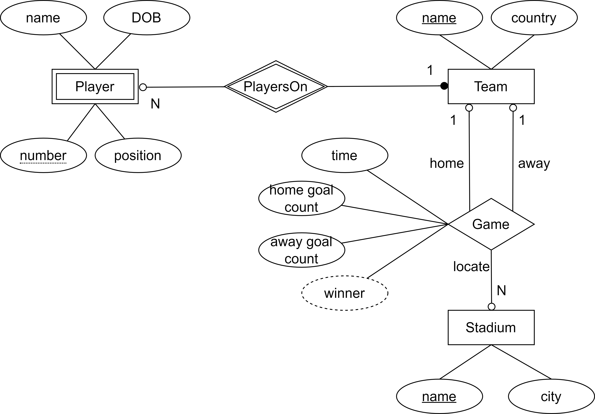

# Women's World Cup Database and Management Interface

- **Unit**: Database Systems (`ISYS2014`)
- **Study Period**: 2023 Trimester 3A
- **Degree Programme**: Bachelor of Information Technology — Awarded with Distinction by Curtin University
- **Overall Unit Mark**: 80 (High Distinction)

SQL-based cleaning and import for FootyStats national-team datasets, demonstrated with the 2019 and 2023 Women's World Cups. The project combines a relational database, analytical SQL, stored procedures and trigger demonstrations with a Python management interface.

## Assignment context and constraints

The assignment required a database for a real-world Women's World Cup scenario: identify entities and relationships, produce an ER model and relational schema, implement the tables and integrity constraints, and load enough sample data to answer meaningful questions. Queries needed to demonstrate filtering, date and string operations, joins, subqueries, grouping and aggregation. Advanced database programming had to include stored procedures and another category of features, with demonstrations of their use. A programming-language interface also had to retrieve and modify data, supported by a design report, reflection and user guide.

This implementation models one tournament per database. It uses teams, players, stadiums and games, with one national team per country. The 2019 and 2023 datasets demonstrate reuse of the schema and import process across tournaments.

## Design and implementation

### Relational model



- `Team` uses the team name as its primary key and constrains country names to be unique.
- `Player` uses a composite team-and-shirt-number key and references its team.
- `Stadium` stores a venue name and city.
- `Game` references its home team, away team and stadium, and uses game time plus both teams as its key. A stored generated column derives the winner from the scores. Deleting a stadium sets the corresponding game location to `NULL`.

### Import and cleaning in SQL

An integrated SQL import and cleaning pipeline, with automatic column labels for query output.

The import scripts load raw CSV data directly through `LOAD DATA LOCAL INFILE`; no separate preprocessing program is required for the demonstrated datasets. Teams use selected CSV fields. Player and match records first enter temporary text tables, then SQL expressions select and transform the fields needed by the relational schema:

- Trim text and split comma-separated fields with `TRIM` and `SUBSTRING_INDEX`.
- Convert dates and match timestamps using `STR_TO_DATE`.
- Assign generated identifiers above 1000 where player shirt numbers are `N/A`.
- Extract stadium names and host cities from match records, and insert distinct venues.
- Convert scores to numeric values and populate the related tables.

CSV fields are selected by position, including indexing from the end for shirt numbers. Automatic column labels refer to the Python query output: `cursor.column_names` supplies the headers displayed by `tabulate`.

### Queries and advanced SQL

The query scripts cover players by age or date of birth, team squads, games by team, stadium or city, goal summaries, and tournament placements. Ordinary SQL views provide formatted team, player, stadium and match results; a window-function query helps identify the final four teams.

`advanced.sql` defines stored procedures and selects demonstration parameters from the loaded teams and venues. Its trigger demonstration adds a games-played counter, inserts a sample game, changes one participating team, and deletes the sample to show the counter updates. The demonstration then removes its triggers and temporary counter column.

### Python interface

The menu supports viewing and retrieving records, inserting, updating and deleting data, switching between tournament databases, and explicitly committing or discarding changes. Views are loaded from `dependency/views.sql` for the retrieval menus. Result tables obtain their headings from the returned database columns.

## Files

| File | Purpose |
|---|---|
| `dependency/table.sql` | Tables, keys and referential constraints |
| `dependency/value_2019.sql`, `dependency/value_2023.sql` | Dataset imports and cleaning |
| `dependency/queries.sql` | Example analytical queries and views |
| `dependency/advanced.sql` | Stored procedures and trigger demonstrations |
| `dependency/views.sql` | Views used by the Python menus |
| `sql.sql` | Recreate both demonstration databases and run the SQL demonstrations |
| `python.sql` | Recreate and populate both databases for the Python interface |
| `main.py` | Interactive database management program |

## Data source and downloads

Download the **Match CSV**, **Teams CSV** and **Players CSV** exports for the **2019/2019** and **2023/2023** seasons from [FootyStats Women's World Cup datasets](https://footystats.org/international/womens-world-cup/datasets). The original six exports are not distributed in this repository.

Place the downloaded files under the project root using these paths:

```text
sample_data/
  2019/
    international-womens-world-cup-matches-2019-to-2019-stats.csv
    international-womens-world-cup-teams-2019-to-2019-stats.csv
    international-womens-world-cup-players-2019-to-2019-stats.csv
  2023/
    international-womens-world-cup-matches-2023-to-2023-stats.csv
    international-womens-world-cup-teams-2023-to-2023-stats.csv
    international-womens-world-cup-players-2023-to-2023-stats.csv
```

## Set up and run

Use MySQL 8 or later, a MySQL account with permissions to create the demonstration databases, and Python 3. The original user guide uses Linux. Enable local-file loading on the MySQL server and client for the CSV imports.

From the project root, open the MySQL client:

```bash
mysql --local-infile=1 -u root -p
```

Choose one setup route. Both scripts recreate `wwc2023_demo` and `wwc2019_demo`.

For the SQL queries, procedures and trigger demonstrations:

```sql
SOURCE sql.sql;
USE wwc2023_demo;
SELECT * FROM TeamView;
CALL GetPlayersByAge(18, 25);
```

For the Python interface, initialise the tables and sample values:

```sql
SOURCE python.sql;
```

Then, in a terminal in the project root:

```bash
python3 -m pip install mysql-connector-python tabulate
python3 main.py
```

Follow the username and password prompts, then choose `2023`, `2019` or a database name. Leaving the password prompt empty uses `MYSQL_PASSWORD` if set; entering `blank` requests an empty password. Use the menu's **Commit Changes** command to save edits or **Discard Changes** to roll them back.
